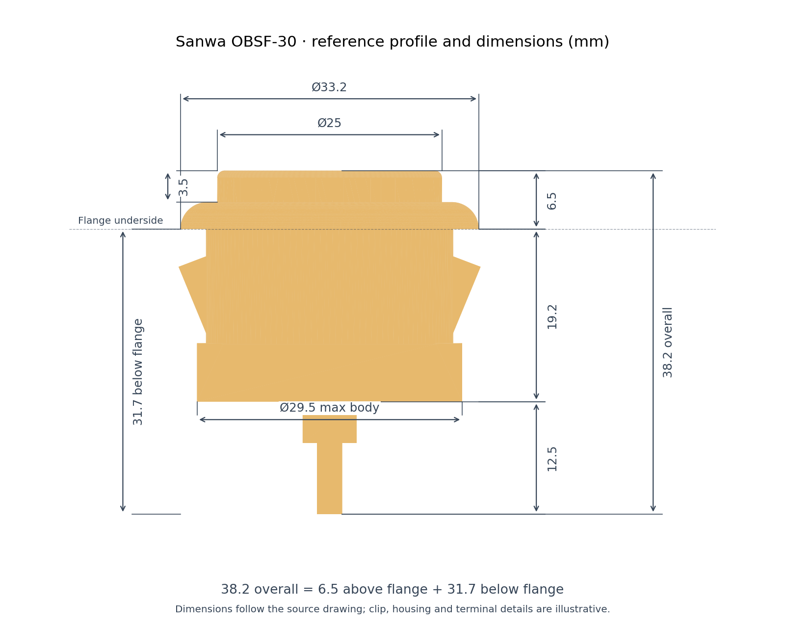
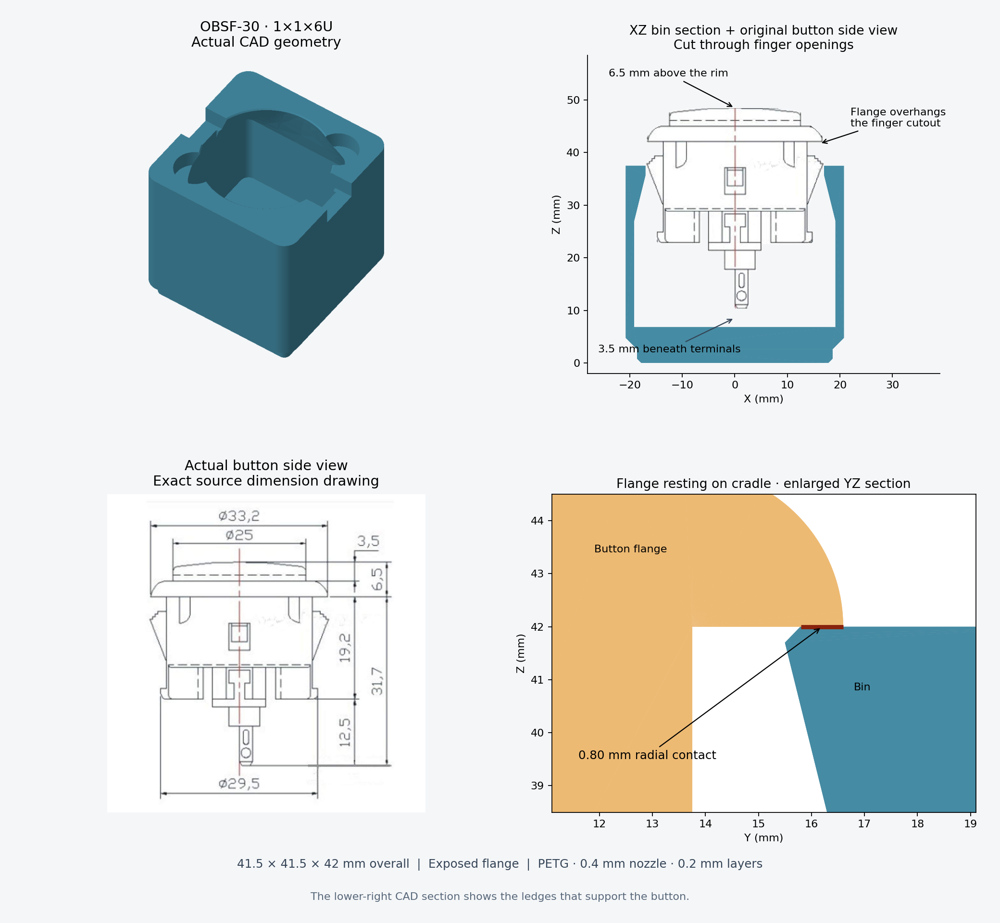

# Arcade Buttons × Gridfinity

[Rim-stop lids](#drop-in-lids-for-existing-bins) hold Sanwa OBSF-24 and OBSF-30
arcade buttons in existing Gridfinity bins. To remove a button, lift the lid,
squeeze the clips from underneath, and push the button out.


The designs are digitally validated prototypes. Printed fit and clip
engagement still need a physical check.

## Single-button holders

The **1×1×6U holder** seats one OBSF-30 with its cap 6.5 mm above the rim and
its terminals 3.5 mm above the floor. Two open side cutouts let you lift the
button by its flange. Use the **1×1×7U recessed bin** when you want to stack
another bin above a loaded button. Start with a fit coupon before printing
a full holder.

- [Saved design plan](PLAN.md)
- Exposed-flange holder [STL](output/obsf30_1x1_6u_exposed.stl) and [STEP](output/obsf30_1x1_6u_exposed.step)
- Recessed stacking bin [STL](output/obsf30_1x1_7u.stl) and [STEP](output/obsf30_1x1_7u.step)
- Fit-coupon STLs: [30.6 mm](output/fit_coupon_30p6.stl),
  [31.0 mm](output/fit_coupon_31p0.stl), [31.4 mm](output/fit_coupon_31p4.stl)
- [Inspection assembly](output/inspection_assembly.step): bin, shaped button
  reference, and the foot of a bin stacked above it. **Do not print this assembly.**
- Exposed holder [inspection assembly](output/inspection_assembly_exposed.step),
  [parameters](output/parameters_exposed.json), and [validation](output/validation_exposed.json)
- Stacking bin [parameters](output/parameters.json) and [validation](output/validation.json)
- [Editable CadQuery source](button_bin.py)

## Drop-in lids for existing bins

The multi-button lids use rounded bin rims from ABDELat's Ultimate Gridfinity
Bins collection. Choose the matching 1×4 or 2×4 footprint and check that the
bin has enough depth for the button terminals.
[Bin collection](https://makerworld.com/en/models/47599-ultimate-gridfinity-bins-collection-parametric)

### Five-button 1×4 rim-stop lid for Sanwa OBSF-24

The [STL](output/obsf24_1x4_rim_stop_snap_lid_24p3_mw47599.stl) and
[STEP](output/obsf24_1x4_rim_stop_snap_lid_24p3_mw47599.step) hold five
buttons in a straight row on 32 mm centers. The 27.2 mm flanges have
4.8 mm of space between neighbors and 6.15 mm at each end of the row.
[OBSF-24 dimension drawing](https://m.media-amazon.com/images/I/51gVxMsMtcL.jpg)

The 41.5 × 167.5 mm lid uses five 24.3 mm bores with 28.6 mm underside
recesses. Each recess leaves a 2.4 mm clip engagement thickness. The
full rim stop sits 1.2 mm above the bin rim, and the 37 × 163 mm rounded
locator extends 2 mm into the opening.

Checks against the supplied `1x4x7u.stl` found about 0.35 mm of
clearance around the locator and at least 7.5 mm beneath the bare
terminal tips at all five positions. Printed rim fit and clip
engagement still need a physical check.

Print the STL in PETG as imported, with the button-facing side flat on
the bed and the clip recesses facing up.

```bash
/home/gkp/codes/.headless/bin/python button_lid.py --rim-stop-snap 1x4
```

### Four-button 1×4 rim-stop lid for Sanwa OBSF-30

The [STL](output/obsf30_1x4_rim_stop_snap_lid_30p5_mw47599.stl) and
[STEP](output/obsf30_1x4_rim_stop_snap_lid_30p5_mw47599.step) fit the
supplied `1x4x7u.stl` bin. The 41.5 × 167.5 mm lid holds four buttons on
42 mm centers, leaving 8.8 mm between adjacent flanges. Each 30.5 mm
opening has a 34.6 mm underside recess and a 2.4 mm clip engagement
thickness.

The full rim stop raises the button face 1.2 mm above the rim. Checks
against the bin mesh found 0.35 mm of locator clearance per side and
at least 7.7 mm below the bare terminal tips. Printed fit and clip
engagement still need a physical check.

Print the STL in PETG as imported, with the button-facing side on the
bed and the clip recesses facing up.

```bash
/home/gkp/codes/.headless/bin/python button_lid.py --rim-stop-snap 1x4 --button obsf30
```

### Eight-button 2×4 lid with a rim stop

Use the [rim-stop STL](output/obsf30_2x4_rim_stop_snap_lid_30p5_mw47599.stl)
for the supplied `2x4x7u.stl` if the flush lid drops into the bin. The full
lip rests on all four sides of the rim and lifts the button face by 1.2 mm.
A 2.0 mm locator fits inside the opening to keep the lid centered. The eight
30.5 mm openings and 2.4 mm clip engagement thickness match the flush version.

Print in PETG as imported, with the broad button face on the bed and the clip
recesses facing up. The model is also available as
[STEP](output/obsf30_2x4_rim_stop_snap_lid_30p5_mw47599.step).

```bash
/home/gkp/codes/.headless/bin/python button_lid.py --rim-stop-snap
```

### Flush eight-button lid for the 2×4 bin

The [2×4 lid STL](output/obsf30_2x4_flush_snap_lid_30p5_mw47599.stl)
and [STEP](output/obsf30_2x4_flush_snap_lid_30p5_mw47599.step) fit the
rim of the supplied `2x4x7u.stl`. The 79 × 163 × 3.2 mm plate seats
flush and holds eight OBSF-30 buttons on 42 mm centers. Each 30.5 mm
opening has an underside recess that leaves 2.4 mm for the clips.

The 2×4 STL is already oriented for printing in PETG, with the flat
button-facing side on the bed and the eight recessed openings facing up.
If you sliced the earlier file, replace it and slice again so the new
orientation takes effect. Lift the loaded lid out to squeeze the clips
from underneath.

```bash
/home/gkp/codes/.headless/bin/python button_lid.py --flush-snap 2x4
```

### Flush 30.5 mm snap-in lid for ABDELat Ultimate Gridfinity

The [flush snap-in STL](output/obsf30_1x1_flush_snap_lid_30p5_mw47599.stl)
and [STEP](output/obsf30_1x1_flush_snap_lid_30p5_mw47599.step) seat inside
the rounded rim of the MakerWorld 1×1 bin. The button presses into a single
30.5 mm round opening. The underside recess leaves a 2.4 mm mounting
thickness for the clips. To release the button, lift the lid out by the
button flange and squeeze the clips from underneath.

Use a taller 1×1 bin with the same rim and **at least 32.7 mm of clear depth**
under the rim where the terminals sit. The supplied 38.55 mm-tall bin was
used to verify the rim fit. Its floor would interfere with the terminal tips
by about 0.35 mm when assembled with the flush lid.
[MakerWorld profile 49320](https://makerworld.com/en/models/47599-ultimate-gridfinity-bins-collection-parametric#profileId-49320)

Print in PETG with the flat button-facing side on the bed and the recessed
underside facing up. Check that the plate seats flush, the button flange
sits flat, and both clips latch and release. Check terminal clearance in
the taller bin before seating the loaded lid.

```bash
/home/gkp/codes/.headless/bin/python button_lid.py --flush-snap
```

### Above-rim lids with clip slots

Try the [30.6 mm lid](output/obsf30_1x1_lid_30p6.stl) first. The
[30.2 mm lid](output/obsf30_1x1_lid_30p2.stl) trims another 0.4 mm off the
body opening. These prototypes have a 2.4 mm plate and a 1.2 mm tapered
locator. The button flange rests on top, and smaller finger holes leave
more material beneath it. Align the clips with the slots for vertical
insertion and removal. The button and lid lift out by hand.

The locator was sized for a square **40.3 mm opening at the rim** and a
**37.9 mm opening 1.2 mm below it**, with 0.4 mm clearance per side. These
are the dimensions of this project's stacking rim. Check your bin before
printing. With the default plate thickness, allow at least **30.5 mm**
from the bin rim to the first obstruction below the terminal tips.
An exposed button occupies the space above the bin.

#### Above-rim lids fitted to ABDELat's 1×1 bin

For the supplied 38.55 mm tall bin from MakerWorld profile 49320, use the
locators fitted to its rounded rim:

- Start with the [30.6 mm STL](output/obsf30_1x1_lid_30p6_mw47599.stl) · [STEP](output/obsf30_1x1_lid_30p6_mw47599.step).
- Try the [30.2 mm STL](output/obsf30_1x1_lid_30p2_mw47599.stl) · [STEP](output/obsf30_1x1_lid_30p2_mw47599.step) if the button still feels loose.

The supplied mesh leaves about 2 mm under the terminal tips when the lid
is seated. Other heights in the 1×1 profile need their own depth check.
[MakerWorld source](https://makerworld.com/en/models/47599-ultimate-gridfinity-bins-collection-parametric#profileId-49320)

```bash
/home/gkp/codes/.headless/bin/python button_lid.py --rim-profile makerworld-47599
```

Print flat with the wide, flat face on the bed and the tapered locator
pointing up. Flip the lid in the slicer to get this orientation.

[30.6 mm STEP](output/obsf30_1x1_lid_30p6.step) ·
[30.2 mm STEP](output/obsf30_1x1_lid_30p2.step)

To fit a different square bin rim, regenerate with its measured opening
widths and corner radius:

```bash
/home/gkp/codes/.headless/bin/python button_lid.py --opening 30.6 \
  --rim-opening 40.3 --lower-opening 37.9 --rim-corner-radius 3.15
```

## Button drawings and dimensions



| Button feature | OBSF-30 (mm) | OBSF-24 (mm) |
|---|---:|---:|
| Fixed flange diameter | 33.2 | 27.2 |
| Moving cap diameter | 25.0 | 19.5 |
| Maximum dimensioned body diameter | 29.5 | 23.5 |
| Top to flange underside | 6.5 | 5.8 |
| Cap height above fixed flange top | 3.5 | 3.0 |
| Flange underside to lower housing plane | 19.2 | 18.2 |
| Lower housing plane to terminal tips | 12.5 | 13.8 |
| Flange underside to terminal tips | 31.7 | 32.0 |
| **Overall top-to-tip height** | **38.2** | **37.8** |

The below-flange dimension determines how much space the button needs
under its mounting surface. [OBSF-30 source drawing](https://m.media-amazon.com/images/I/51oVK7HhGFL.jpg) ·
[OBSF-24 source drawing](https://m.media-amazon.com/images/I/51gVxMsMtcL.jpg)

The shaped OBSF-30 reference uses the drawing's dimensioned extents.
Clip shapes, housing details, and terminal spacing are approximate.

<details>
<summary>Original OBSF-30 dimension drawing</summary>


</details>

## Holder and stacking bin dimensions



The exposed holder's XZ section passes through the finger openings. The
enlarged YZ section shows the supporting ledge, with the 0.80 mm radial
contact marked in red.

The exposed holder measures 41.5 × 41.5 × 42 mm. Its side cutouts are 10 mm
wide and 4.5 mm deep. The Gridfinity foot fits a baseplate, and the exposed
button occupies the space above the holder. The table below describes the
recessed model for stacking.

| Feature | Millimetres |
|---|---:|
| Grid pitch | 42 × 42 |
| Exterior footprint | 41.5 × 41.5 |
| Nominal height / stacking pitch | 49 (7U) |
| Overall height, including trimmed lip | 52.8 |
| Body opening | 31.0 |
| Flange recess diameter | 34.2 |
| Clip relief | 34 along X × 8 along Y |
| Wall thickness | 1.6 |
| Floor elevation from underside of foot | 6.8 |
| Flange seat elevation | 40.5 |
| Button top elevation | 47.0 |
| Lower housing plane elevation | 21.3 |
| Terminal tip elevation | 8.8 |
| Space under terminals / above button | 2.0 / 2.0 |

The model derives overall button height from `top_above_flange` (6.5 mm) plus
`flange_to_terminal` (31.7 mm). The fixed flange underside rests on the cradle;
the terminals end 2 mm above the interior floor. A recessed 6U configuration
is rejected by the parameter checks.

The relief dimensions are initial allowances, not measured dimensions of the
uncompressed clips. The button must be oriented with its two clips pointing
along the long direction of the relief opening (X). No clip compression should
be needed. Clear, silent, RG, screw-in, and other brands are not qualified by
this first model.

The Gridfinity base follows the common 4.75 mm foot profile and a 41.5 mm body
on a 42 mm grid. The stacking socket uses a 4.4 mm theoretical profile trimmed
by 0.6 mm at the crown, giving a 3.8 mm printed lip. Profile dimensions are based
on the [community reference](https://github.com/gridfinity-unofficial/specification).
Physical compatibility with your particular baseplate and other bins still
needs checking.

## Print and fit the standalone holder

1. Print the **31.0 mm fit coupon** flat with its engraved number facing up:
   PETG, 0.4 mm nozzle, 0.2 mm layers, four perimeters, no supports. Use your
   calibrated PETG temperatures and bed settings; leave XY scaling at 100%.
2. Hold the coupon above the table while inserting the button: terminals
   protrude through this short gauge. Align the clips with the opposed reliefs.
   Check that the fixed flange seats and lifts out freely without squeezing
   clips or prying. The engraved number is the body-opening diameter.
3. If the body opening binds, try 31.4 mm. If it feels unnecessarily loose,
   try 30.6 mm. If a clip catches, enlarge `clip_span` or `clip_width` rather
   than assuming a larger round hole will solve it.
4. Compare your button with the exact drawing: 6.5 mm above the flange underside
   and 31.7 mm below it. If your variant differs, update the parameters and
   regenerate before printing the full bin.
5. Print the bin upright, foot on the bed: same PETG settings, four perimeters,
   about 15% infill, and no supports as the starting setup. Check the slicer's
   overhang preview and layer paths; the cradle underside is a 15 mm tall gradual
   loft, checked to stay within 46° from vertical on its tessellated underside.
6. Check baseplate fit, flange support, finger access, terminal clearance,
   and vertical removal. For the recessed 7U variant, stack an empty bin
   above the loaded bin and confirm it seats without actuating the button.

The coupons test the local body/flange/clip fit. The full bin is required to
qualify reach, terminal protection, and stacking. This is a storage holder;
it is not designed for playing on the button or retaining it upside down.

## Regenerate

Use the existing Python environment at `/home/gkp/codes/.headless`.
CadQuery generates the solids and exports; Matplotlib generates the preview.
Install dependencies into that environment if needed:

```bash
/home/gkp/codes/.headless/bin/pip install -r requirements.txt
```

Run from the repository root to generate the exposed 6U holder and its
section drawing (`output/holder_preview.png`).

```bash
/home/gkp/codes/.headless/bin/python button_bin.py
```

Regenerate the README overview (`output/preview.png`) from the current CAD
models with the preview script.

```bash
/home/gkp/codes/.headless/bin/python preview.py
```

Pass a JSON configuration to customize the holder. Include both
`"height_u": 6` and `"exposed_flange": true` for the exposed version. A config
without these fields uses the recessed 7U default. For example:

```json
{
  "height_u": 6,
  "exposed_flange": true,
  "body_opening": 31.4,
  "clip_span": 34.4
}
```

```bash
/home/gkp/codes/.headless/bin/python button_bin.py --config fit.json --output output-adjusted
```

Units are millimetres. Clearances named `flange_clearance` are **diametral**.
Regeneration writes four individual STEP/STL pairs, an inspection assembly,
a preview, a dimensioned button reference, parameters, and validation results.
The three coupon diameters stay
30.6/31.0/31.4 mm; other coupon dimensions follow the selected parameters.

Old JSON configurations containing `button_height` are rejected because that
value previously encoded the incorrect datum. Remove it and set
`flange_to_terminal: 31.7`, `top_above_flange: 6.5`, and `height_u: 7` (or taller).
Overall height is now a derived value, not a configurable field.

## Validation

The holder generator checks connected solids, STEP round trips, STL edge closure
and winding, flange support, and the button removal path. It checks finger access
on the exposed holder and stacking clearance on the recessed bin. The holder
clearance tests use a simplified envelope for the body and flange.

The lid generator checks connected solids and watertight, consistently wound
STLs. Geometry tests cover cradle overhangs, clip reliefs, button dimensions,
snap-lid hole positions and recesses, rim stops, and multi-button STL print
orientation. Run the tests from the repository root.

```bash
/home/gkp/codes/.headless/bin/pip install pytest
/home/gkp/codes/.headless/bin/python -m pytest -q
```

## Planned models

- Lid fits for additional bin profiles, including the
  [Simple Gridfinity Box](https://makerworld.com/en/models/784676-simple-gridfinity-box-stackable-many-sizes).
- Larger layouts using the validated button cradle on the 42 mm grid.
