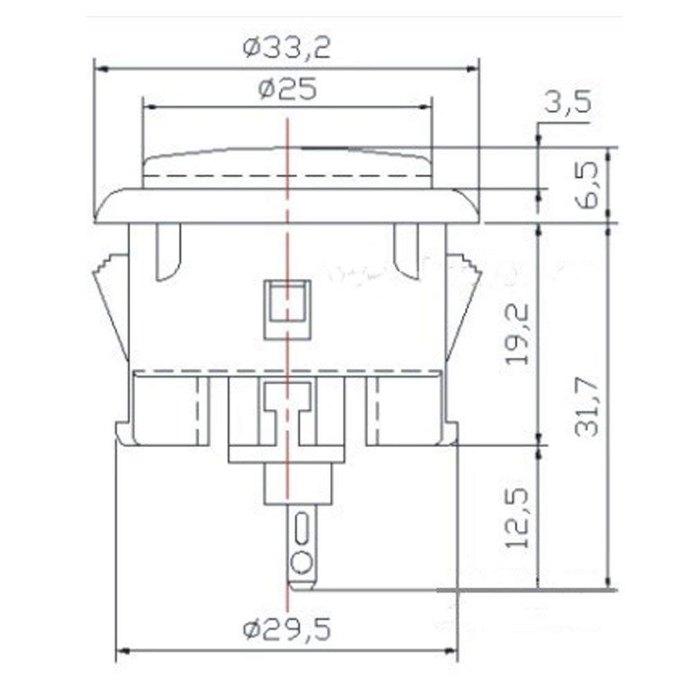

# Arcade Buttons × Gridfinity

Parametric 3D-printable storage for arcade buttons, starting with
**one Sanwa OBSF-30 snap-in button in a 1×1×7U Gridfinity bin**.
The button drops into a flange cradle, with its switch and bare terminals
suspended above the floor. Opposed clip reliefs prevent intentional snap-in
retention; diagonal finger wells provide access beneath the fixed flange.

**Status: digitally validated prototype; physical fit has not been verified.**
Start with the [31.0 mm fit coupon](output/fit_coupon_31p0.stl) before printing
the full bin. OBSF-24 models and inserts for existing bins are planned.


The middle panel overlays the original button side-view linework on the bin's
XZ section, aligned to the button top, flange underside, lower housing plane,
and terminal tips. The cut passes through the clip reliefs. Orange shows the supporting ledges projected from the perpendicular section. This is a side-view projection for visual comparison;
physical clip fit still needs checking. The full source drawing appears at right.

## Files

- [Saved design plan](PLAN.md)
- [Bin STL](output/obsf30_1x1_7u.stl) and [STEP](output/obsf30_1x1_7u.step)
- Fit-coupon STLs: [30.6 mm](output/fit_coupon_30p6.stl),
  [31.0 mm](output/fit_coupon_31p0.stl), [31.4 mm](output/fit_coupon_31p4.stl)
- [Inspection assembly](output/inspection_assembly.step): bin, shaped button
  reference, and the foot of a bin stacked above it. **Do not print this assembly.**
- [Parameters used](output/parameters.json) and [validation results](output/validation.json)
- [Editable CadQuery source](button_bin.py)

## Button drawing and dimensions


These dimensions come from the [exact reference drawing](https://m.media-amazon.com/images/I/51oVK7HhGFL.jpg):

| Button feature | Millimetres |
|---|---:|
| Fixed flange diameter | 33.2 |
| Moving cap diameter | 25.0 |
| Maximum dimensioned body diameter | 29.5 |
| Top to flange underside | 6.5 |
| Cap height above fixed flange top | 3.5 |
| Flange underside to lower housing plane | 19.2 |
| Lower housing plane to terminal tips | 12.5 |
| Flange underside to terminal tips | 31.7 |
| **Overall top-to-tip height** | **38.2 = 6.5 + 31.7** |

**31.7 mm is measured from the flange underside.** The earlier 6U model
mistakenly treated it as the overall height. Those exports have been removed;
use the corrected 7U model. With the existing floor and 2 mm top clearance,
the old 6U bin would have 5 mm of terminal/floor interference.

The CAD reference now shows the rounded fixed flange, moving cap, barrel,
retention clips, lower housing, and terminal blades. Its dimensioned extents
follow the drawing. Undimensioned clip shapes, housing depth, barrel details,
and terminal spacing are illustrative; the drawing does not fully specify
those features for manufacturing or prove their fit.

<details>
<summary>Exact source drawing</summary>



Source: [Amazon-hosted dimension image](https://m.media-amazon.com/images/I/51oVK7HhGFL.jpg).

</details>

## Bin fit and dimensions

| Feature | Millimetres |
|---|---:|
| Grid pitch | 42 × 42 |
| Exterior footprint | 41.5 × 41.5 |
| Nominal height / stacking pitch | 49 (7U) |
| Overall height, including trimmed lip | 52.8 |
| Body opening | 31.0 |
| Flange recess diameter | 34.2 |
| Clip relief | 34 along X × 8 along Y |
| Wall thickness | 1.6 |
| Floor elevation from underside of foot | 6.8 |
| Flange seat elevation | 40.5 |
| Button top elevation | 47.0 |
| Lower housing plane elevation | 21.3 |
| Terminal tip elevation | 8.8 |
| Space under terminals / above button | 2.0 / 2.0 |

The model derives overall button height from `top_above_flange` (6.5 mm) plus
`flange_to_terminal` (31.7 mm). The fixed flange underside rests on the cradle;
the terminals end 2 mm above the interior floor. A standard 6U configuration
is rejected by the parameter checks.

The relief dimensions are initial allowances, not measured dimensions of the
uncompressed clips. The button must be oriented with its two clips pointing
along the long direction of the relief opening (X). No clip compression should
be needed. Clear, silent, RG, screw-in, and other brands are not qualified by
this first model. OBSF-24 and inserts for existing bins are planned follow-ups.

The Gridfinity base follows the common 4.75 mm foot profile and a 41.5 mm body
on a 42 mm grid. The stacking socket uses a 4.4 mm theoretical profile trimmed
by 0.6 mm at the crown, giving a 3.8 mm printed lip. Profile dimensions are based
on the [community reference](https://github.com/gridfinity-unofficial/specification).
Physical compatibility with your particular baseplate and other bins still
needs checking.

## Print and fit sequence

1. Print the **31.0 mm fit coupon** flat with its engraved number facing up:
   PETG, 0.4 mm nozzle, 0.2 mm layers, four perimeters, no supports. Use your
   calibrated PETG temperatures and bed settings; leave XY scaling at 100%.
2. Hold the coupon above the table while inserting the button: terminals
   protrude through this short gauge. Align the clips with the opposed reliefs.
   Check that the fixed flange seats and lifts out freely without squeezing
   clips or prying. The engraved number is the body-opening diameter.
3. If the body opening binds, try 31.4 mm. If it feels unnecessarily loose,
   try 30.6 mm. If a clip catches, enlarge `clip_span` or `clip_width` rather
   than assuming a larger round hole will solve it.
4. Compare your button with the exact drawing: 6.5 mm above the flange underside
   and 31.7 mm below it. If your variant differs, update the parameters and
   regenerate before printing the full bin.
5. Print the bin upright, foot on the bed: same PETG settings, four perimeters,
   about 15% infill, and no supports as the starting setup. Check the slicer's
   overhang preview and layer paths; the cradle underside is a 15 mm tall gradual
   loft, checked to stay within 46° from vertical on its tessellated underside.
6. Check baseplate fit, flange support, finger access, terminal clearance,
   and vertical removal. Stack an empty bin above the loaded bin and confirm
   it seats without touching or actuating the button.

The coupons test the local body/flange/clip fit. The full bin is required to
qualify reach, terminal protection, and stacking. This is a storage holder;
it is not designed for playing on the button or retaining it upside down.

## Regenerate

Use the existing Python environment at `/home/gkp/codes/.headless`.
CadQuery generates the solids and exports; Matplotlib generates the preview.
Install dependencies into that environment if needed:

```bash
/home/gkp/codes/.headless/bin/pip install -r requirements.txt
```

Run from the repository root:

```bash
/home/gkp/codes/.headless/bin/python button_bin.py
```

Override any field of `Parameters` with a JSON file, for example:

```json
{
  "body_opening": 31.4,
  "clip_span": 34.4
}
```

```bash
/home/gkp/codes/.headless/bin/python button_bin.py --config fit.json --output output-adjusted
```

Units are millimetres. Clearances named `flange_clearance` are **diametral**.
Regeneration writes four individual STEP/STL pairs, an inspection assembly,
a preview, a dimensioned button reference, parameters, and validation results.
The three coupon diameters stay
30.6/31.0/31.4 mm; other coupon dimensions follow the selected parameters.

Old JSON configurations containing `button_height` are rejected because that
value previously encoded the incorrect datum. Remove it and set
`flange_to_terminal: 31.7`, `top_above_flange: 6.5`, and `height_u: 7` (or taller).
Overall height is now a derived value, not a configurable field.

## Validation

Every generation checks connected valid solids, STEP round trips, exported STL edge
closure and winding, button-envelope removal, and stacking interference.
The button envelope deliberately overestimates the lower body but **omits clips**;
these checks cannot establish physical clip fit or compensate for printer error.

The geometry regression suite checks unsafe parameter combinations, cradle
overhangs, flange support, continuous clip reliefs, a larger 8U variant, and
the exact drawing's vertical datums. It rejects the unsafe 6U case and checks
the shaped reference's height. The suite contains **16 passing tests**. To run it:

```bash
/home/gkp/codes/.headless/bin/pip install pytest
/home/gkp/codes/.headless/bin/python -m pytest -q
```

## Planned models

- Sanwa OBSF-24 with its own button dimensions.
- Removable inserts fitted to measured bin interiors, including the
  [Simple Gridfinity Box](https://makerworld.com/en/models/784676-simple-gridfinity-box-stackable-many-sizes).
- Larger layouts using the validated button cradle on the 42 mm grid.
