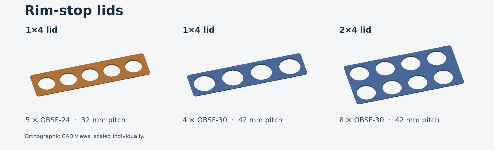

# Arcade Buttons × Gridfinity

Gridfinity storage for Sanwa OBSF-24 and OBSF-30 arcade buttons and
35 mm joystick ball tops. The [mixed 3×3 bin](#mixed-33-arcade-bin)
holds eight buttons and one ball top. All four lid layouts come with and
without an 8 mm lift tab. The [5U ball-top bin](#joystick-ball-top-bin)
holds four balls in separate compartments.

## Mixed 3×3 arcade bin


The 125.5 × 125.5 mm bin uses a 42 mm pitch and nine Gridfinity feet.
Two dividers separate the 5U ball-top corner from the shared 7U button
cavity and support the inside corner of the removable L-shaped lid. The
rims are 31.55 mm and 45.55 mm above the base, respectively.

| Row \ Column | 1 | 2 | 3 |
|---|---|---|---|
| 1 | 35 mm ball top | OBSF-24 | OBSF-24 |
| 2 | OBSF-30 | OBSF-30 | OBSF-30 |
| 3 | OBSF-30 | OBSF-30 | OBSF-30 |

| Part | Files | STL orientation |
|---|---|---|
| 3×3 bin | [STL](output/bins/arcade_3x3_5u_7u_bin.stl) · [STEP](output/bins/arcade_3x3_5u_7u_bin.step) | Feet down |
| L-shaped lid without tab | [STL](output/lids/arcade_3x3_rim_stop_snap_lid_no_tab.stl) · [STEP](output/lids/arcade_3x3_rim_stop_snap_lid_no_tab.step) | Button face down |
| L-shaped lid with 8 mm lift tab | [STL](output/lids/arcade_3x3_rim_stop_snap_lid_lift_tab_8mm.stl) · [STEP](output/lids/arcade_3x3_rim_stop_snap_lid_lift_tab_8mm.step) | Button face down |

The lid covers all eight button positions. Its rim stop is 1.2 mm thick,
the locator reaches 2 mm into the cavity, and the clips engage across
2.4 mm of material. An 8 mm lift tab extends from the short edge behind
the two OBSF-24 buttons. The STEP models share coordinates with the lid seated.

The ball sits on a 3 mm high centering ring with an 18 mm bore, a 23 mm
outside diameter, and a rounded contact edge. About 11 mm of a 35 mm ball
projects above the low rim, with access from both outside edges.

CAD checks confirmed straight lift paths for the lid and ball, with
7.55 mm of clearance below the bare OBSF-24 terminals and 7.85 mm below
the bare OBSF-30 terminals. The bin and both lids have watertight STLs
and valid STEP solids.

## Drop-in lids for existing bins



| Bin footprint | Buttons | Center spacing | Without tab | With 8 mm lift tab |
|---|---|---:|---|---|
| 1×4 | 5 × OBSF-24 | 32 mm | [STL](output/lids/obsf24_1x4_rim_stop_snap_lid_24p3_mw47599_no_tab.stl) · [STEP](output/lids/obsf24_1x4_rim_stop_snap_lid_24p3_mw47599_no_tab.step) | [STL](output/lids/obsf24_1x4_rim_stop_snap_lid_24p3_mw47599_lift_tab_8mm.stl) · [STEP](output/lids/obsf24_1x4_rim_stop_snap_lid_24p3_mw47599_lift_tab_8mm.step) |
| 1×4 | 4 × OBSF-30 | 42 mm | [STL](output/lids/obsf30_1x4_rim_stop_snap_lid_30p5_mw47599_no_tab.stl) · [STEP](output/lids/obsf30_1x4_rim_stop_snap_lid_30p5_mw47599_no_tab.step) | [STL](output/lids/obsf30_1x4_rim_stop_snap_lid_30p5_mw47599_lift_tab_8mm.stl) · [STEP](output/lids/obsf30_1x4_rim_stop_snap_lid_30p5_mw47599_lift_tab_8mm.step) |
| 2×4 | 8 × OBSF-30 | 42 mm | [STL](output/lids/obsf30_2x4_rim_stop_snap_lid_30p5_mw47599_no_tab.stl) · [STEP](output/lids/obsf30_2x4_rim_stop_snap_lid_30p5_mw47599_no_tab.step) | [STL](output/lids/obsf30_2x4_rim_stop_snap_lid_30p5_mw47599_lift_tab_8mm.stl) · [STEP](output/lids/obsf30_2x4_rim_stop_snap_lid_30p5_mw47599_lift_tab_8mm.step) |

### Lift-tab lids

The 8 mm lift tab extends across one short end. Leave the tab end
accessible for a fingertip below the lip.
The tab projects into the space above the next Gridfinity cell.

### Bin and button fit

The lids were sized for the rounded rims on `1x4x7u.stl` and `2x4x7u.stl`
from ABDELat's Ultimate Gridfinity Bins collection. The full lip rests on
all four sides of the rim, raising the button mounting face by 1.2 mm.
A 2 mm locator centers the lid inside the opening.
[Bin collection](https://makerworld.com/en/models/47599-ultimate-gridfinity-bins-collection-parametric)

| Bin footprint | Lid without tab | Lid with tab | Rounded locator |
|---|---:|---:|---:|
| 1×4 | 41.5 × 167.5 mm | 41.5 × 175.5 mm | 37 × 163 mm |
| 2×4 | 83.5 × 167.5 mm | 83.5 × 175.5 mm | 79 × 163 mm |

| Fit dimension | OBSF-24 | OBSF-30 |
|---|---:|---:|
| Snap-in opening | 24.3 mm | 30.5 mm |
| Underside clip recess diameter | 28.6 mm | 34.6 mm |
| Button flange diameter | 27.2 mm | 33.2 mm |
| Flange underside to bare terminal tips | 32.0 mm | 31.7 mm |
| Bare terminal reach below the bin rim | 30.8 mm | 30.5 mm |

The lid leaves 2.4 mm of material at each opening for the clips to engage.
The five-button layout leaves 4.8 mm between flanges, and the OBSF-30 layouts
leave 8.8 mm. [OBSF-24 drawing](https://m.media-amazon.com/images/I/51gVxMsMtcL.jpg) ·
[OBSF-30 drawing](docs/obsf30-dimensions.jpg)

Checks against the 1×4 reference mesh found about 0.35 mm of locator
clearance per side and at least 7.5 mm below the bare terminals for the
OBSF-24 lid or 7.7 mm for the OBSF-30 lid. Check terminal clearance in
your bin before seating the loaded lid.

## Print and use

1. Print in PETG. The bin STLs are feet-down, and the lid STLs have the
   button face on the bed with the clip recesses facing up.
2. Press each button into its matching opening with the lid off the bin.
   Check that each flange seats flat and both clips engage, then seat the
   loaded lid on the bin rim.
3. To remove a button, lift the whole lid, squeeze the clips from underneath,
   and push the button out.
4. Lift the ball top straight up. On the 3×3 bin, grasp it from the two
   low outside edges with the lid still seated.

Printed rim fit, clip engagement, and grip comfort still need a physical check.

## Joystick ball-top bin

The **1×4×5U bin** has three 1.8 mm dividers, paired finger scoops, and
the same rounded centering ring in each of its four compartments.
About 11 mm of each seated ball sits above the rim so you can pinch it
from the sides. Print upright with the Gridfinity feet on the bed.
[Print-ready STL](output/bins/balltop_1x4_5u_35mm.stl) ·
[Faceted STEP](output/bins/balltop_1x4_5u_35mm.step)

The STL and STEP adapt ABDELat's Ultimate Gridfinity 1×4×7U bin by
shortening the walls by 14 mm and adding the dividers, scoops, and seats.
These two remix files are shared under CC BY-SA 4.0.
[Original bin collection](https://makerworld.com/en/models/47599-ultimate-gridfinity-bins-collection-parametric) ·
[CC BY-SA 4.0](https://creativecommons.org/licenses/by-sa/4.0/)

A 36 mm gauge cleared the straight removal path in all four positions in CAD.

## Regenerate

From the repository root, use your Python environment with
[CadQuery and Matplotlib](requirements.txt).
The generators save models to `output/bins` and `output/lids`, and images
to `output/previews`.

```bash
python -m pip install -r requirements.txt
```

```bash
# Mixed 3×3 bin and both L-shaped lids
python arcade_bin.py

# 1×4 lid for five OBSF-24 buttons
python button_lid.py --rim-stop-snap 1x4

# 1×4 lid for four OBSF-30 buttons
python button_lid.py --rim-stop-snap 1x4 --button obsf30

# 1×4 lift-tab lids
python button_lid.py --rim-stop-snap 1x4 --lift-tab
python button_lid.py --rim-stop-snap 1x4 --button obsf30 --lift-tab

# 2×4 lids for eight OBSF-30 buttons
python button_lid.py --rim-stop-snap 2x4
python button_lid.py --rim-stop-snap 2x4 --lift-tab

# README previews
python preview.py
```

To rebuild the ball-top bin, use the 1×4×7U mesh from the original bin
collection as input to the [ball-top generator](balltop_bin.py).

```bash
python balltop_bin.py --source 1x4x7u.stl
```

The generators check the solids and exported STL meshes. Geometry tests cover
the bore layout, clip recesses, rim stops, print orientation, and the mixed
bin's removal paths and terminal clearance.

```bash
python -m pip install pytest
python -m pytest -q
```
