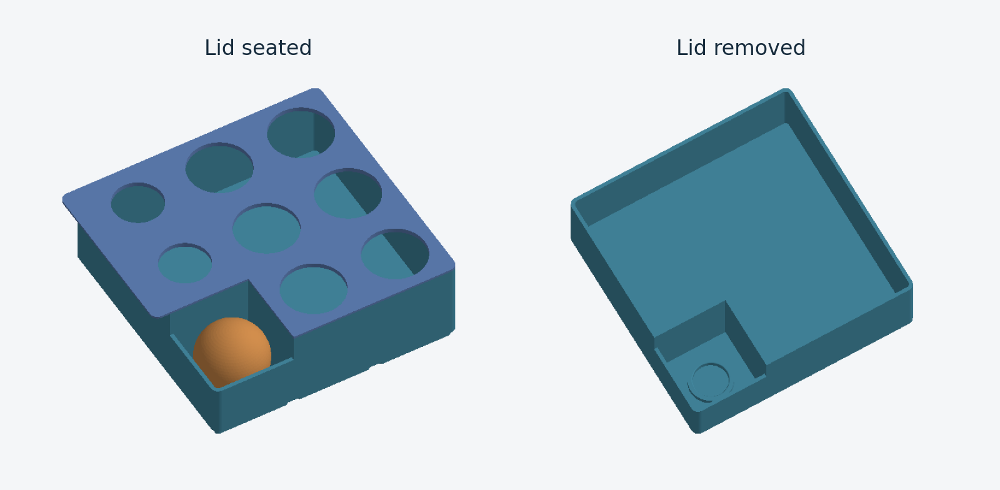
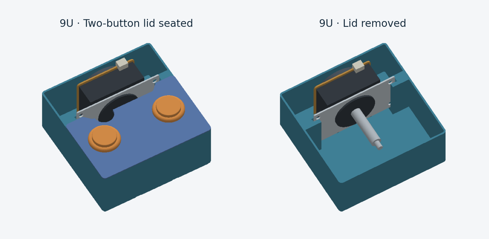

# Sanwa Buttons Joystick Storage x Gridfinity

Gridfinity storage for Sanwa OBSF-24 and OBSF-30 arcade buttons and
35 mm LB-35 joystick ball tops. The [mixed 3×3 bin](#mixed-33-arcade-bin)
holds eight buttons and one ball top. The [7U and 8U joystick bins](#sanwa-jlf-tp-8yt-joystick-bin)
hold a JLF-TP-8YT sideways. The 8U has a two-button lid over the shaft.
The [4U ball-top bin](#joystick-ball-top-bin) holds four balls in separate
compartments. The mixed-bin and drop-in lids come with and without an 8 mm
lift tab.

## Mixed 3×3 arcade bin



The 125.5 × 125.5 mm bin uses a 42 mm pitch and nine Gridfinity feet.
Two dividers separate the 4U ball-top corner from the shared 5U button cavity
and support the inside corner of the removable L-shaped lid. The mixed bin
name counts full 7 mm units from the bottom of the feet to each rim. The
ball-top rim is 31.55 mm high and the button rim is 38.55 mm high.

| Row \ Column | 1 | 2 | 3 |
|---|---|---|---|
| 1 | LB-35 ball top (35 mm) | OBSF-24 | OBSF-24 |
| 2 | OBSF-30 | OBSF-30 | OBSF-30 |
| 3 | OBSF-30 | OBSF-30 | OBSF-30 |

| Part | Files | STL orientation |
|---|---|---|
| 3×3 4U–5U bin | [STL](output/bins/arcade_3x3_4u_5u_bin.stl) · [STEP](output/bins/arcade_3x3_4u_5u_bin.step) | Feet down |
| L-shaped lid without tab | [STL](output/lids/arcade_3x3_rim_stop_snap_lid_no_tab.stl) · [STEP](output/lids/arcade_3x3_rim_stop_snap_lid_no_tab.step) | Button face down |
| L-shaped lid with 8 mm lift tab | [STL](output/lids/arcade_3x3_rim_stop_snap_lid_lift_tab_8mm.stl) · [STEP](output/lids/arcade_3x3_rim_stop_snap_lid_lift_tab_8mm.step) | Button face down |

The lid covers all eight button positions. Its rim stop is 1.2 mm thick,
the locator reaches 2 mm into the cavity, and the clips engage across
2.4 mm of material. An 8 mm lift tab extends from the short edge behind
the two OBSF-24 buttons. The lid STEP files are seated on the 4U–5U bin.

The ball sits on a 3 mm high centering ring with an 18 mm bore, a 23 mm
outside diameter, and a rounded contact edge. About 11 mm of the seated LB-35
projects above the low rim, with access from both outside edges.

The loaded lid and ball have straight lift paths in CAD. The bare terminal
tips clear the floor by 1.55 mm for the OBSF-24 and 1.85 mm for the OBSF-30.
Check that the loaded lid seats fully on the first print, especially with the
OBSF-24 buttons installed.

## Sanwa JLF-TP-8YT joystick bin



| Part | Rim height | Bare shaft position | Files |
|---|---:|---|---|
| 3×3×7U bin | 52.55 mm | 5.85 mm below rim | [STL](output/bins/jlf_tp_8yt_3x3_7u_bin.stl) · [STEP](output/bins/jlf_tp_8yt_3x3_7u_bin.step) |
| 3×3×8U bin | 59.55 mm | 12.85 mm below rim | [STL](output/bins/jlf_tp_8yt_3x3_8u_bin.stl) · [STEP](output/bins/jlf_tp_8yt_3x3_8u_bin.step) |
| 8U shaft-bay lid for two OBSF-30 buttons | — | 10.85 mm below lid underside | [STL](output/lids/jlf_tp_8yt_3x3_8u_shaft_bay_lid.stl) · [STEP](output/lids/jlf_tp_8yt_3x3_8u_shaft_bay_lid.step) |

Both bins have a 125.5 × 125.5 mm footprint. Unplug the harness, turn the
5-pin connector upward and lower the 95 × 54 mm plate into the tapered
1.9 mm slots. The seats put the lower plate edge **7 mm above the floor**
and 14.2 mm above the bin base. These dimensions come from the printed
test fixture, where both the PCB and restrictor cleared the floor.
[Fixture STL](output/test_fixtures/jlf_tp_8yt_plate_seat_7mm.stl) ·
[STEP](output/test_fixtures/jlf_tp_8yt_plate_seat_7mm.step)

Both open bins also clear the LB-35 when attached. Remove the ball top
to use the 8U lid. The seated mounting plate reaches 68.2 mm above the
base in either bin. Measure the highest point on the assembled joystick
for drawer clearance.

The lid rests on the front and side rims. Each rear shoulder bears on
about 63 mm² of the front ledge of its plate guide. A 2 mm deep locator
fits between the front rim and the guides, with 0.35 mm of play in each
direction from center. Seat the dust washer against the plate. With the
parts centered, the lid's middle rear edge clears the washer by 7.2 mm
and leaves the mounting plate and electronics accessible.

The OBSF-30 centers sit 37 mm to either side of the shaft and 20 mm forward
of the bin center. Each 30.5 mm bore has a 34.6 mm underside clip recess
and a 2.4 mm snap panel. The bare terminal tips clear the floor by 21.85 mm.
Hook a fingertip into the off-center recess at the rear edge to lift the
loaded lid straight up, then lift the joystick by its plate. Both lift paths
were checked in CAD. On the full-size print, check that both plate ends
reach their seats and that the PCB and restrictor clear the floor.

Print the bin STLs feet down and the lid STL button face down. The 8U bin
and lid STEP files share seated assembly coordinates.

The CAD fit check allows 81 mm across the body and up to 6 mm of PCB or
restrictor projection below the lower plate edge. That envelope leaves
1 mm of modeled floor clearance.
[Reference dimensions](https://m.media-amazon.com/images/I/41RymBEab1L._AC_UF350,350_QL80_.jpg) ·
[Dimensioned bottom view](https://www.diyretroarcade.com/cdn/shop/files/8MWfs.jpg) ·
[Underside photo](https://www.arcadexpress.com/35-medium_default/sanwa-jlf-tp-8yt-arcade-joystick.jpg) ·
[Sanwa JLF catalog, pp. 4–5](https://rs2006.co.jp/e/sanwaseimitsu/Sanwa2020.pdf#page=3)

## Joystick ball-top bin

The **1×4×4U bin** is 31.55 mm tall and holds four LB-35 ball tops. It has
three 1.8 mm dividers, paired finger scoops, and a rounded centering ring in
each compartment.
About 11 mm of each seated ball sits above the rim so you can pinch it
from the sides. Print upright with the Gridfinity feet on the bed.
[Print-ready STL](output/bins/balltop_1x4_4u.stl) ·
[Faceted STEP](output/bins/balltop_1x4_4u.step)

The STL and STEP adapt ABDELat's Ultimate Gridfinity 1×4×7U bin by
shortening the walls by 14 mm and adding the dividers, scoops, and seats.
These two remix files are shared under CC BY-SA 4.0.
[Original bin collection](https://makerworld.com/en/models/47599-ultimate-gridfinity-bins-collection-parametric) ·
[CC BY-SA 4.0](https://creativecommons.org/licenses/by-sa/4.0/)

A 36 mm gauge cleared the straight removal path in all four positions in CAD.

## Drop-in lids for existing bins


| Bin footprint | Buttons | Center spacing | Without tab | With 8 mm lift tab |
|---|---|---:|---|---|
| 1×4 | 5 × OBSF-24 | 32 mm | [STL](output/lids/obsf24_1x4_rim_stop_snap_lid_24p3_mw47599_no_tab.stl) · [STEP](output/lids/obsf24_1x4_rim_stop_snap_lid_24p3_mw47599_no_tab.step) | [STL](output/lids/obsf24_1x4_rim_stop_snap_lid_24p3_mw47599_lift_tab_8mm.stl) · [STEP](output/lids/obsf24_1x4_rim_stop_snap_lid_24p3_mw47599_lift_tab_8mm.step) |
| 1×4 | 4 × OBSF-30 | 42 mm | [STL](output/lids/obsf30_1x4_rim_stop_snap_lid_30p5_mw47599_no_tab.stl) · [STEP](output/lids/obsf30_1x4_rim_stop_snap_lid_30p5_mw47599_no_tab.step) | [STL](output/lids/obsf30_1x4_rim_stop_snap_lid_30p5_mw47599_lift_tab_8mm.stl) · [STEP](output/lids/obsf30_1x4_rim_stop_snap_lid_30p5_mw47599_lift_tab_8mm.step) |
| 2×4 | 8 × OBSF-30 | 42 mm | [STL](output/lids/obsf30_2x4_rim_stop_snap_lid_30p5_mw47599_no_tab.stl) · [STEP](output/lids/obsf30_2x4_rim_stop_snap_lid_30p5_mw47599_no_tab.step) | [STL](output/lids/obsf30_2x4_rim_stop_snap_lid_30p5_mw47599_lift_tab_8mm.stl) · [STEP](output/lids/obsf30_2x4_rim_stop_snap_lid_30p5_mw47599_lift_tab_8mm.step) |

### Lift-tab lids

The 8 mm lift tab extends across one short end. Leave the tab end
accessible for a fingertip below the lip.
The tab projects into the space above the next Gridfinity cell.

### Bin and button fit

The lids were sized for the rounded rims on `1x4x7u.stl` and `2x4x7u.stl`
from ABDELat's Ultimate Gridfinity Bins collection. The full lip rests on
all four sides of the rim, raising the button mounting face by 1.2 mm.
A 2 mm locator centers the lid inside the opening.
[Bin collection](https://makerworld.com/en/models/47599-ultimate-gridfinity-bins-collection-parametric)

| Bin footprint | Lid without tab | Lid with tab | Rounded locator |
|---|---:|---:|---:|
| 1×4 | 41.5 × 167.5 mm | 41.5 × 175.5 mm | 37 × 163 mm |
| 2×4 | 83.5 × 167.5 mm | 83.5 × 175.5 mm | 79 × 163 mm |

| Fit dimension | OBSF-24 | OBSF-30 |
|---|---:|---:|
| Snap-in opening | 24.3 mm | 30.5 mm |
| Underside clip recess diameter | 28.6 mm | 34.6 mm |
| Button flange diameter | 27.2 mm | 33.2 mm |
| Flange underside to bare terminal tips | 32.0 mm | 31.7 mm |
| Bare terminal reach below the bin rim | 30.8 mm | 30.5 mm |

The lid leaves 2.4 mm of material at each opening for the clips to engage.
The five-button layout leaves 4.8 mm between flanges, and the OBSF-30 layouts
leave 8.8 mm. [OBSF-24 drawing](https://m.media-amazon.com/images/I/51gVxMsMtcL.jpg) ·
[OBSF-30 drawing](docs/obsf30-dimensions.jpg)

Checks against the 1×4 reference mesh found about 0.35 mm of locator
clearance per side and at least 7.5 mm below the bare terminals for the
OBSF-24 lid or 7.7 mm for the OBSF-30 lid. Check terminal clearance in
your bin before seating the loaded lid.

## Print and use

1. Print in PETG. The bin STLs are feet-down, and the lid STLs have the
   button face on the bed with the clip recesses facing up.
2. Press each button into its matching opening with the lid off the bin.
   Check that each flange seats flat and both clips engage, then seat the
   loaded lid on the bin rim.
3. To remove a button, lift the whole lid, squeeze the clips from underneath,
   and push the button out.
4. On the mixed 3×3 bin, leave the button lid seated and grasp the loose
   ball top from the two low outside edges to lift it straight up.

Printed rim fit, clip engagement, and grip comfort still need a physical check.

## Regenerate

From the repository root, use your Python environment with
[CadQuery and Matplotlib](requirements.txt).
The generators save models to `output/bins` and `output/lids`, and images
to `output/previews`.

```bash
python -m pip install -r requirements.txt
```

```bash
# Mixed 3×3 4U–5U bin and both L-shaped lids
python arcade_bin.py

# Sideways Sanwa JLF-TP-8YT joystick bins (7U and 8U) and 8U lid
python joystick_bin.py

# JLF plate-seat fixture with production slot width and seat height
python joystick_plate_fixture.py
```

To rebuild the ball-top bin, use the 1×4×7U mesh from the original bin
collection as input to the [ball-top generator](balltop_bin.py).

```bash
python balltop_bin.py --source 1x4x7u.stl
```

```bash
# 1×4 lid for five OBSF-24 buttons
python button_lid.py --rim-stop-snap 1x4

# 1×4 lid for four OBSF-30 buttons
python button_lid.py --rim-stop-snap 1x4 --button obsf30

# 1×4 lift-tab lids
python button_lid.py --rim-stop-snap 1x4 --lift-tab
python button_lid.py --rim-stop-snap 1x4 --button obsf30 --lift-tab

# 2×4 lids for eight OBSF-30 buttons
python button_lid.py --rim-stop-snap 2x4
python button_lid.py --rim-stop-snap 2x4 --lift-tab

# README previews
python preview.py
```

The generators check the solids and exported STL meshes. Geometry tests cover
the bore layouts, clip recesses, rim stops, print orientation, and the removal
paths and terminal clearance in the mixed and joystick bins.

```bash
python -m pip install pytest
python -m pytest -q
```
